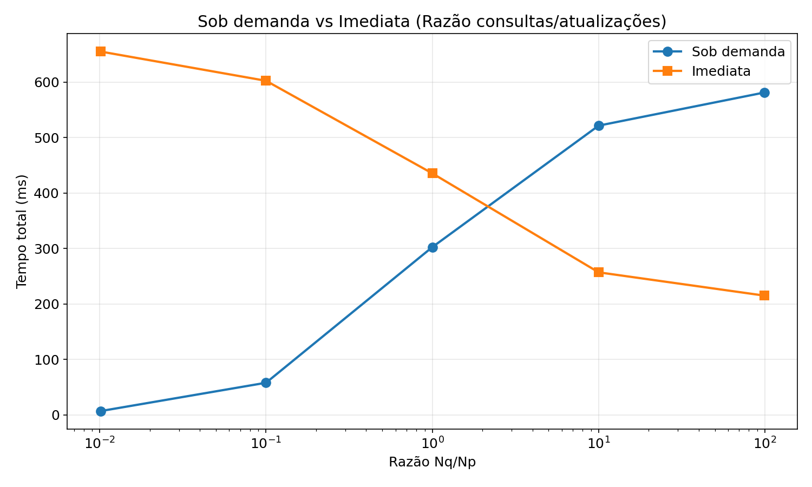
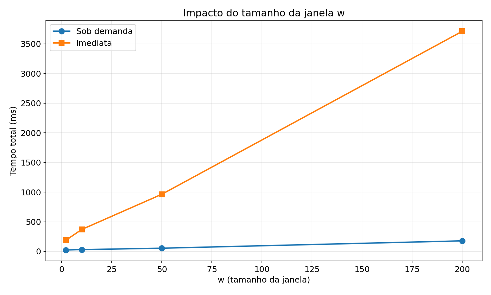
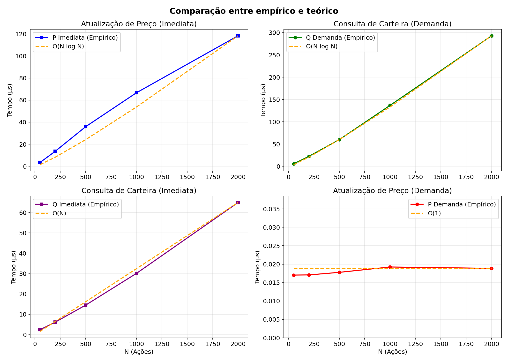

# TP1 - Análise de Carteiras de Ações

Mantém uma janela deslizante de cotações de ações e responde a consultas ponderadas de melhores/piores ações sobre as carteiras dos clientes, comparando duas estratégias de ranqueamento (sob demanda vs. imediata).

## Problema

O programa lê uma sequência de comandos da entrada padrão:

| Comando | Significado |
| :--- | :--- |
| `M w METRIC...` | Configuração: tamanho da janela `w` e as métricas ativas (subconjunto de `RET`, `AVGRET`, `STAB`, `CONS`) |
| `A id` / `U id` | Declara uma ação / um cliente (IDs sequenciais a partir de 0) |
| `P stock price` | Nova cotação de uma ação |
| `B client stock` / `V client stock` | Cliente compra / vende uma ação |
| `Q qid client n m METRIC weight ...` | Consulta: ranqueia as ações do cliente usando `m` métricas ponderadas e imprime as `n` melhores e as `n` piores |

Cada métrica é calculada sobre as últimas `w` cotações de uma ação:

- `RET`: retorno total, `p[w-1] / p[0] - 1`
- `AVGRET`: média dos retornos elementares `p[i] / p[i-1] - 1`
- `STAB`: `1 / (1 + volatility)`, em que a volatilidade é o desvio padrão dos retornos elementares
- `CONS`: fração de retornos elementares positivos

Em uma consulta, todas as ações do mercado são ranqueadas por cada métrica solicitada (em ordem decrescente, com empates desfeitos pelo menor ID). Uma ação na posição `pos` recebe `(N - pos) * weight` pontos por métrica; em seguida, as ações do cliente são ordenadas pela pontuação total e as linhas de saída são `R qid M i stock score` (melhores) e `R qid P i stock score` (piores). Ações com menos de `w` cotações recebem um valor sentinela (`-1e18`), de modo que ficam no fim do ranking.

## Estruturas de dados

| Módulo | Estrutura | Motivo |
| :--- | :--- | :--- |
| `Acao` | Buffer circular de capacidade `w` | Só as últimas `w` cotações importam; inserção em O(1), e a cotação mais antiga é sobrescrita automaticamente |
| `Cliente` | Vetor booleano de tamanho `N` indexado pelo ID da ação | Compra, venda e teste de pertinência em O(1) |
| `Ranqueamento` | Mergesort estável sobre structs auxiliares `(id, value)` | O(N log N) garantido; ordenar referências mantém o vetor de ações indexado por ID |
| `Sistema` | Vetor linear `K x N` de posições no ranking (`[k*N + a]`) mais buffers de ordenação pré-alocados | Consulta em O(1) da posição de uma ação em cada métrica; nenhuma alocação por comando |

## Estratégias

Escolhidas em tempo de compilação pela variável `STRATEGIA` do Makefile:

- **`DEMANDA` (sob demanda, padrão):** `P` apenas armazena a cotação. As métricas são calculadas e ordenadas quando chega um `Q`.
- **`IMEDIATA` (imediata):** cada `P` recalcula todas as métricas ativas para todas as ações e reordena os rankings globais, de modo que `Q` apenas lê os rankings já prontos.

## Complexidade

`N` ações, janela `w`, `K` métricas ativas, `m` métricas em uma consulta, `C` ações na carteira do cliente.

| Operação | Sob demanda | Imediata |
| :--- | :--- | :--- |
| `P` (cotação) | O(1) | O(K * N * (w + log N)) |
| `Q` (consulta) | O(m * N * (w + log N) + C log C) | O(m * N + C log C) |
| `B` / `V` | O(1) | O(1) |
| Espaço | O(N * w + u * N + K * N) | igual, mais O(K * N) para os rankings armazenados |

## Organização

```
TP-1/
  project/      Makefile, include/, src/ (C++11)
  tests/        inputs/in_*.txt e expected-outputs/out_*.txt
  analysis/     benchmark.py, resultados.csv, gráficos
  report/       TP1_report.pdf (+ fonte .tex)
```

## Compilação e execução

Requer `g++` e `make`. A partir de `TP-1/`:

```bash
make -C project all                      # sob demanda (padrão)
make -C project clean
make -C project all STRATEGIA=IMEDIATA   # imediata
```

Execute `make clean` ao trocar de estratégia: os arquivos objeto não acompanham a flag e, por isso, não seriam recompilados. O binário é `project/bin/tp1.out` e lê da entrada padrão:

```bash
./project/bin/tp1.out < tests/inputs/in_0.txt
```

## Testes

A partir de `TP-1/`, o script abaixo compila as duas estratégias e compara (com `diff`) a saída de cada entrada com a saída esperada:

```bash
for S in DEMANDA IMEDIATA; do
  make -C project clean >/dev/null
  make -C project all STRATEGIA=$S >/dev/null
  for in in tests/inputs/in_*.txt; do
    out=tests/expected-outputs/out_${in##*in_}
    ./project/bin/tp1.out < "$in" | diff -q - "$out" >/dev/null \
      && echo "$S PASS $in" || echo "$S FAIL $in"
  done
done
make -C project clean
```

Os 10 testes passam com as duas estratégias.

## Análise experimental

`analysis/benchmark.py` gera entradas sintéticas, compila as duas estratégias com `-O2 -DBENCHMARK`, executa cada cenário 3 vezes (mediana) e grava `resultados.csv` e os gráficos em `analysis/`. O script interpreta as linhas `BENCH <P|Q> <ops> <ns>` emitidas no stderr; essa instrumentação de tempo não faz parte do código entregue, então é preciso adicioná-la sob `#ifdef BENCHMARK` para refazer os experimentos. Os gráficos exigem `matplotlib`.

Os cenários usam `N = 500`, `w = 10` e as métricas `RET` + `STAB`, exceto quando o parâmetro em questão está sendo variado.







Resultados:

- **Razão consultas/atualizações:** a estratégia sob demanda vence quando predominam as atualizações (7 ms vs 655 ms com `Nq/Np = 0.01`); a imediata vence quando predominam as consultas (215 ms vs 581 ms com `Nq/Np = 100`). O ponto de cruzamento fica entre `Nq/Np = 1` e `10`, em torno de 3 a 5.
- **Número de ações:** os tempos por operação seguem as curvas previstas: o `P` sob demanda permanece constante (~0.02 us), o `P` imediato e o `Q` sob demanda crescem como O(N log N), e o `Q` imediato como O(N). Com `N = 2000` e poucas consultas, a estratégia imediata fica cerca de 20x mais lenta no total.
- **Tamanho da janela:** `w` prejudica mais a estratégia imediata, já que cada cotação recalcula as métricas de todas as ações: de `w = 2` a `w = 200`, seu tempo total cresce de 186 ms para 3712 ms, enquanto o da sob demanda vai de 24 ms para 178 ms.

Nenhuma estratégia é melhor em todos os casos: a escolha apenas desloca o custo entre o tempo de inserção e o de consulta.

Relatório completo: [report/TP1_report.pdf](report/TP1_report.pdf).
