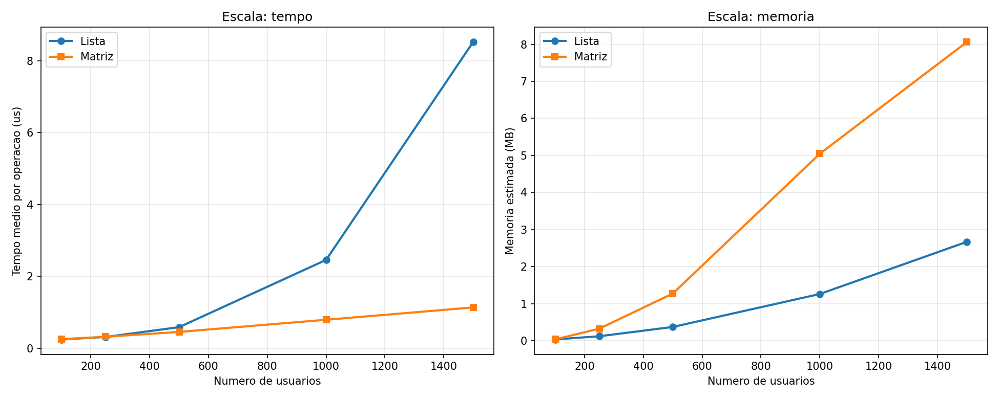
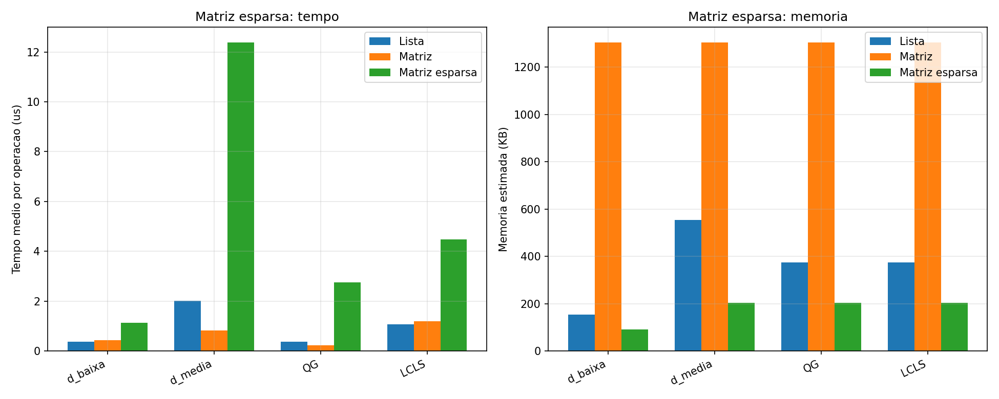

# TP2 - Modelagem de uma Rede Social Acadêmica

Segundo trabalho prático de **DCC221 - Estruturas de Dados** (UFMG, 2026/1), por Thales Alves Amaral.

Programa em C++11 orientado a comandos ("ConectaDCC") que modela uma rede social acadêmica por meio de dois grafos construídos sobre um único TAD genérico `Grafo`. O grafo pode alternar, em tempo de execução, entre lista de adjacência, matriz de adjacência e (como extra) matriz esparsa, sem perda de dados. Há também um comando extra, `P`, que recomenda usuários. O projeto inclui uma comparação experimental entre as representações.

## Problema

O sistema mantém usuários, temas de interesse e relações de "seguir", armazenados em dois grafos:

- **Grafo social**: direcionado e não ponderado. Uma aresta `u -> v` indica que o usuário `u` segue o usuário `v`.
- **Grafo de temas**: não direcionado, não ponderado e bipartido. Uma aresta liga um usuário a um tema pelo qual ele se interessa.

Usuários e temas têm IDs sequenciais próprios a partir de 0, então o usuário 0 e o tema 0 são vértices distintos. O programa lê um comando por linha da entrada padrão e imprime uma linha de saída para cada comando. As listas são impressas em ordem crescente de ID. Toda entrada é considerada válida.

### Comandos de entrada

| Comando | Significado | Saída |
|---|---|---|
| `A <L\|M\|E>` | Alterna ambos os grafos para lista de adjacência / matriz / matriz esparsa (`E` é extra) | `A <mode>` |
| `T <name> <A\|P>` | Cadastra um tema (acadêmico ou pessoal) | `T <id>` |
| `U <name> <age> [topicIds...]` | Cadastra um usuário e o associa a temas | `U <id>` |
| `S <u> <v>` / `R <u> <v>` | `u` passa a seguir / deixa de seguir `v` | `S`/`R <nameU> <nameV>` |
| `LT <u>` | Temas do usuário `u` | `LT <name> <topics...>` |
| `LC <u>` | Seguidores de `u` (predecessores) | `LC <name> <users...>` |
| `LS <u>` | Usuários que `u` segue (sucessores) | `LS <name> <users...>` |
| `LA <u>` | Amigos de `u` (seguimento mútuo) | `LA <name> <users...>` |
| `Q <u> <v>` | Relação: 0 nenhuma, 1 u->v, 2 v->u, 3 ambas | `Q <nameU> <nameV> <code>` |
| `G <u> <t>` | O usuário `u` se interessa pelo tema `t`? | `G <nameU> <nameT> <0\|1>` |
| `F <t>` | Popularidade do tema `t` (número de usuários) | `F <nameT> <count>` |
| `P <u> <topk> <wProx> <wAfin>` | (Extra) Top-k recomendações de usuários | `P <name> <users...>` |

## Estruturas de dados

| TAD / arquivo | Papel e justificativa |
|---|---|
| `Usuario`, `Tema` | Classes simples de entidade (id, nome, idade / tipo). |
| `No` | Conteúdo do vértice: ID externo mais o tipo (`USUARIO`/`TEMA`). Isso permite que um único grafo genérico armazene usuários e temas, mesmo quando seus IDs coincidem. |
| `Dicionario` | Vetores redimensionáveis indexados diretamente pelo ID externo. Guardam as entidades e mapeiam cada ID para o seu **índice interno de vértice** em cada grafo. Como os IDs são densos e sequenciais, as buscas são O(1) e não é preciso hashing. |
| `Grafo` | Grafo genérico (direcionado ou não) com três modos de armazenamento intercambiáveis. **Lista**: listas simplesmente encadeadas com inserção na cabeça; o grafo direcionado mantém também uma lista de *entrada*, de modo que `LC` custa O(grau de entrada) em vez de uma varredura completa. **Matriz**: `bool**`. **Esparsa**: vetores paralelos de pares (linha, coluna). `migrar()` reconstrói a representação ativa e libera a anterior, então apenas uma existe por vez. O vetor de vértices dobra de capacidade quando fica cheio. |
| `Ordenacao` | Merge sort estável implementado à mão sobre IDs. As arestas são armazenadas sem ordem (inserção O(1)), e as listagens só são ordenadas no momento da impressão. |
| `BuffersConsulta` | Vetores auxiliares reutilizáveis (índices, IDs, auxiliar do merge sort, fila da BFS, distâncias, marcações de temas, recomendações). Só crescem quando o grafo cresce, o que evita alocar memória a cada consulta. |
| `Recomendador` | O comando `P` (extra). |

### Extras

- **Matriz esparsa (`A E`)**: armazena apenas as arestas existentes, como pares `(linha, coluna)` em dois vetores redimensionáveis. Arestas não direcionadas são armazenadas nos dois sentidos. A interface pública de `Grafo` não muda. A inserção é O(1) amortizada. Busca, remoção e listagem de vizinhos percorrem todos os pares armazenados (O(E)). A migração entre matriz e esparsa passa pela representação em lista.
- **Recomendação (`P u topk wProx wAfin`)**: executa uma BFS a partir de `u` no grafo social para obter a menor distância `d` até cada um dos outros usuários. A proximidade é `2/d`, ou 0 se o usuário for inalcançável. A afinidade temática é o índice de Jaccard entre os conjuntos de temas dos dois usuários: `|comuns| / |união|`. Cada candidato recebe a pontuação `wProx*proximidade + wAfin*afinidade`. São excluídos dos candidatos o próprio `u` e os usuários que `u` já segue. A lista é ordenada com merge sort (pontuação decrescente com tolerância epsilon, empates resolvidos pelo menor ID), e o programa imprime os `topk` primeiros usuários.

## Complexidade

Notação: `n` usuários, `m` temas, `V` = vértices, `E` = arestas, `d+`/`d-` = grau de saída/entrada, `k` = número de itens na saída.

| Operação | Lista de adjacência | Matriz de adjacência | Matriz esparsa |
|---|---|---|---|
| Inserir aresta (`S`, vínculos de `U`) | O(1) | O(1) | O(1) amortizado |
| Remover aresta (`R`) | O(d+(u) + d-(v)) | O(1) | O(E) |
| Existência de aresta (`Q`, `G`) | O(d+(u)) | O(1) | O(E) |
| Vizinhos de saída (`LS`, `LT`, `F`) | O(d+(u)) + ordenação O(k log k) | O(V) + ordenação | O(E) + ordenação |
| Predecessores (`LC`) | O(d-(u)) + ordenação | O(V) + ordenação | O(E) + ordenação |
| Amigos (`LA`) | O(d+(u) * max d+) + ordenação | O(V) + ordenação | O(E * d+(u)) + ordenação |
| Adicionar vértice (amortizado; custo do redimensionamento) | O(1); O(V) | O(1); O(V^2) | O(1); O(V) |
| Migração (`A`) | lista <-> matriz O(V^2 + E) | | lista <-> esparsa O(V + E) |
| Recomendação `P` | O(n + E_s + n*d+ + E_t + c log c) | O(n * (n+m)) | O(n * E) |
| Espaço | O(n + m + E_s + E_t) | O((n+m)^2) | O(n + m + E_s + E_t) |

## Organização

```
TP-2/
├── project/        Makefile, include/ (headers), src/ (implementação)
├── tests/          case_{1..5}.in / .out  (entradas de exemplo e saídas esperadas)
├── analysis/       CSVs dos experimentos (brutos + resumos) e figuras
└── report/         TP2_report.pdf (relatório final) e seu fonte LaTeX
```

Os scripts que geraram as entradas dos experimentos e os gráficos não foram preservados. Apenas suas saídas (CSVs e PNGs) estão incluídas.

## Compilação, execução e testes

Requer `g++` (C++11) e `make`.

```bash
cd TP-2/project
make                                   # gera bin/tp2.out (bin/ e obj/ são criados automaticamente)
./bin/tp2.out < ../tests/case_1.in     # os comandos são lidos da entrada padrão

# executa todos os testes de exemplo
for i in 1 2 3 4 5; do
  ./bin/tp2.out < ../tests/case_$i.in | diff -q - ../tests/case_$i.out > /dev/null \
    && echo "case_$i PASS" || echo "case_$i FAIL"
done

make clean
```

Os 5 casos de exemplo passam. Reexecutar os casos forçando todo comando `A` para o modo matriz ou esparsa produz a mesma saída (exceto pelas linhas `A` ecoadas), portanto as três representações se comportam da mesma forma nessas entradas.

## Análise experimental

A análise gerou cargas de trabalho sintéticas variando o número de usuários (100 a 1500), a densidade social (0.005 a 0.20), o número de temas, os temas por usuário, a mistura de operações e a frequência de migrações. Cada configuração foi executada 5 vezes e é reportada a mediana. A memória é uma estimativa estrutural do armazenamento do grafo, não o RSS do processo.

<p align="center">
  
</p>

<p align="center">
  
</p>

Principais resultados (valores de `analysis/resumo_*.csv`):

- **Lista vs. matriz é um trade-off entre tempo e memória.** Com 1500 usuários, a lista teve média de cerca de 8.5 us por operação e a matriz de cerca de 1.1 us. A matriz usou cerca de 8.1 MB, contra cerca de 2.7 MB da lista.
- **A densidade prejudica a lista.** Com densidade 0.20, a lista teve média de cerca de 44.6 us por operação e a matriz de cerca de 1.5 us. Nesse cenário, as células da lista também ocupam mais memória do que a matriz de tamanho fixo. `LA` é a consulta mais cara na lista (cerca de 31 us vs. cerca de 2.5 us na matriz), porque cada verificação de reciprocidade percorre uma lista encadeada.
- **Migrações frequentes dominam o custo.** Com um `A` a cada 25 operações, as duas representações ficam em torno de 27 us por operação, contra menos de 1 us sem migrações.
- **`P` favorece a lista em grafos esparsos** (1000 usuários: cerca de 757 us com lista vs. cerca de 1434 us com matriz). Já em grafos densos, favorece a matriz (densidade 0.20: cerca de 6677 us vs. cerca de 1153 us).
- **A matriz esparsa é a mais econômica em memória, mas a mais lenta.** Em baixa densidade, usou cerca de 92 KB, contra cerca de 154 KB da lista e 1304 KB da matriz. Toda busca é uma varredura linear sobre os pares armazenados, então ela é visivelmente mais lenta, e piora conforme a densidade cresce.

As seis figuras e a discussão completa estão no [relatório (PDF)](report/TP2_report.pdf). `report/TP2_report.tex` compila a partir de dentro de `report/`, e suas figuras apontam para `../analysis/`.
