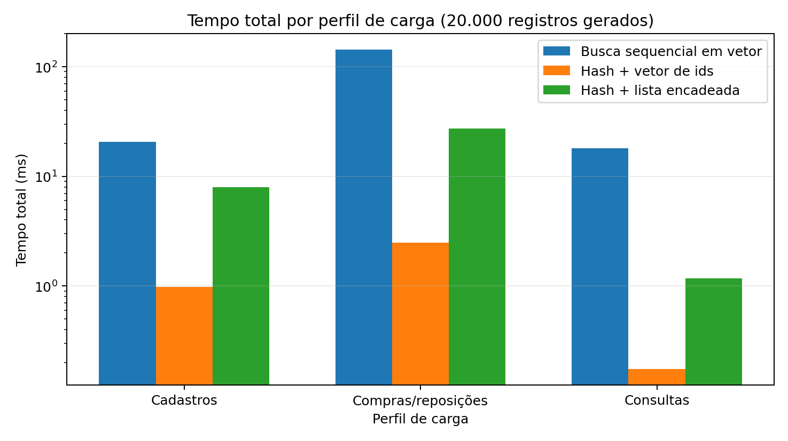
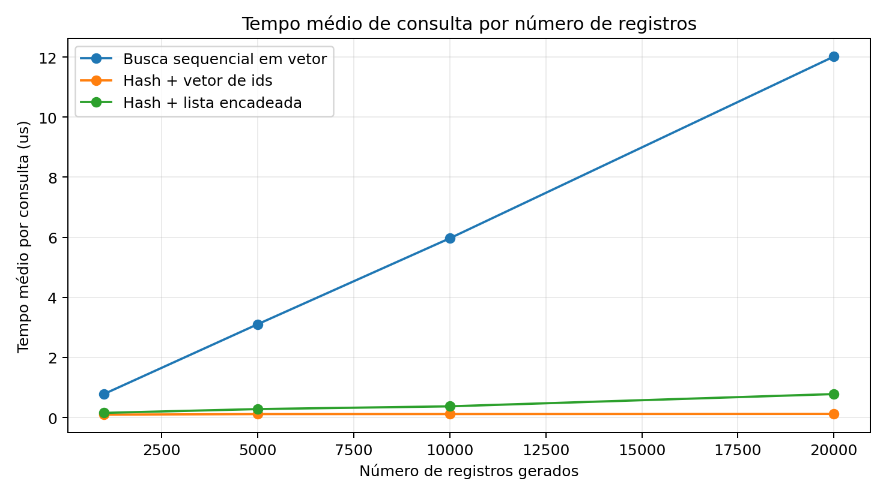
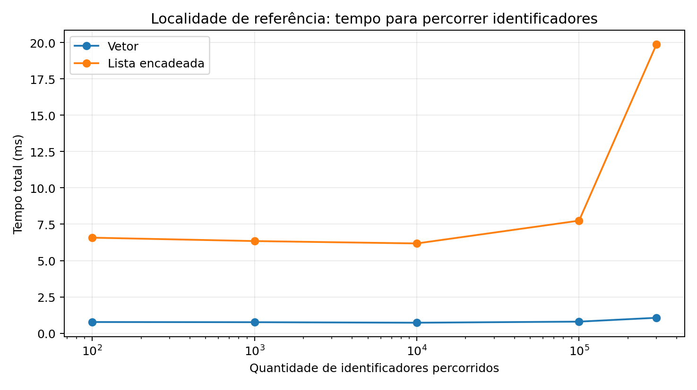

# TP3 - Sistema de E-commerce com Consultas Multiatributo

Terceiro trabalho prático de Estruturas de Dados (DCC221, UFMG, 2026/1), por Thales Alves Amaral.

Programa em C++11 orientado a comandos que armazena usuários, produtos, compras e reposições
de um marketplace fictício ("MercadoDCC") e responde a consultas que filtram qualquer
uma dessas entidades por um ou mais atributos. As consultas são respondidas por meio de
**índices invertidos** construídos sobre **tabelas hash com sondagem linear** implementadas
do zero, que mapeiam cada valor de atributo para uma lista ordenada de ids de entidades. Assim,
uma consulta acessa apenas as entidades candidatas, em vez de percorrer tudo.

## Problema

O programa lê comandos da entrada padrão, um por linha, e os processa em ordem.
As entidades recebem ids inteiros sequenciais a partir de 0 (um contador por tipo de
entidade). Uma compra só é válida se todos os produtos nela tiverem estoque suficiente;
caso contrário, ela é rejeitada e nada é alterado. Cada usuário mantém um histórico
agregado do que comprou, e cada produto mantém um histórico agregado de quem o comprou;
ambos aparecem nos resultados das consultas. Os resultados são sempre impressos em ordem
crescente de id, e as listas de itens em ordem crescente de id de produto.

### Comandos

| Comando | Formato | Saída |
| --- | --- | --- |
| `U` | `U <name> <age> <city> <state> <nationality>` | `U <id>` |
| `P` | `P <name> <price> <qty> <category> <brand> <condition>` | `P <id>` |
| `R` | `R <timestamp> <product> <qty> [<product> <qty> ...]` | `R <id>` (adiciona estoque) |
| `C` | `C <timestamp> <user> <product> <qty> [...]` | `C <id>` ou `C INV` |
| `LU` | `LU <attr> <value> [<attr> <value> ...]` | usuários correspondentes + produtos comprados |
| `LP` | `LP <attr> <value> ...` | produtos correspondentes + compradores |
| `LC` | `LC <attr> <value> ...` | compras válidas correspondentes + itens |
| `LR` | `LR <attr> <value> ...` | reposições correspondentes + itens |

Múltiplos filtros em uma consulta são combinados com AND. Resultados vazios imprimem `LU VAZIO`,
`LP VAZIO` etc. Atributos pesquisáveis:

- usuários: `id`, `nome`, `idade`, `cidade`, `estado`, `nacionalidade`
- produtos: `id`, `nome`, `categoria`, `marca`, `condicao`
- compras: `id`, `timestamp`, `id_usuario`, `id_produto`
- reposições: `id`, `timestamp`, `id_produto`

Exemplo (`tests/base/1.in`, trecho):

```
U Ana 21 BeloHorizonte MG Brasileira        ->  U 0
P Mouse 80.00 5 Informatica Logitech Novo   ->  P 0
C 100 0 0 2 1 1                             ->  C 0
LU cidade BeloHorizonte                     ->  LU resultado_1 usuario 0 Ana 21 BeloHorizonte MG Brasileira
                                                produto_1 0 2 produto_2 1 1
```

## Estruturas de dados

| TAD | Papel | Motivo |
| --- | --- | --- |
| `Usuario`, `Produto`, `Compra`, `Reposicao` | As quatro entidades. Preços são armazenados como centavos inteiros. Usuários/produtos mantêm históricos de compras agregados. | Centavos inteiros evitam erros de arredondamento de ponto flutuante. |
| Arrays de entidades em `Sistema` | Arrays dinâmicos indexados por id. | Os ids são sequenciais, então a busca por `id` é O(1), sem hash. |
| `ListaIds` | Array dinâmico de ids para um valor de atributo. | Os ids são inseridos em ordem de criação, então as listas já ficam ordenadas; a memória contígua garante boa localidade de referência. |
| `IndiceInvertido` | Tabela hash (hash polinomial de strings, sondagem linear, fator de carga mantido abaixo de 50%, duplicação + rehash) que mapeia valor -> `ListaIds`. | Busca em O(1) no caso médio do conjunto de candidatos de cada filtro. |
| `Indices` | Agrupa os índices invertidos de cada tipo de entidade. | Um índice por atributo pesquisável. |
| `BuffersConsulta` | Arrays auxiliares reutilizáveis para resultados parciais, interseção e leitura de itens. | Evita alocações a cada consulta. |
| `Sistema` | Gerencia todas as estruturas; implementa cadastros, compras, reposições e consultas. | Fachada central usada pela `main`. |

Consultas com múltiplos filtros obtêm a lista de ids de cada filtro e fazem a interseção
delas com um merge linear de dois ponteiros (as listas estão ordenadas). Os itens de
compras/reposições são ordenados por id de produto com insertion sort (as listas de itens
são pequenas e frequentemente quase ordenadas).

## Pontos extras

O enunciado oferecia duas extensões opcionais, com testes em `tests/extra-1/` e
`tests/extra-2/`:

- **Extra 1 - consultas booleanas:** filtros combinados com `AND`, `OR` e `NOT`
  (precedência `NOT` > `AND` > `OR`), por exemplo `LU NOT nacionalidade BR AND cidade Bh OR estado RJ`.
- **Extra 2 - consultas por intervalo:** atributos numéricos aceitam um intervalo, por exemplo
  `LU idade 20 25`, `LP preco 70.00 300.00`, `LC timestamp 100 125`, combinados com os
  operadores booleanos.

**Essas extensões não foram implementadas no código entregue.** Nesses conjuntos de teste,
todas as linhas de saída de `U`/`P`/`R`/`C` coincidem com a saída esperada, mas as linhas de
consulta que usam a sintaxe estendida não: o programa imprime `VAZIO` para todas as 39. Veja os
resultados dos testes abaixo.

## Complexidade

`u, p, c, r` = número de usuários, produtos, compras válidas e reposições; `s` = itens em
uma compra/reposição; `f` = filtros em uma consulta; `k_i` = tamanho da lista de ids do
i-ésimo filtro; `T_C, T_R` = total de itens armazenados em compras/reposições. As operações
de hash consideram o caso médio.

| Operação | Tempo |
| --- | --- |
| Cadastro de usuário / produto (`U`, `P`) | O(1) amortizado |
| Reposição (`R`) | O(s^2) (insertion sort dos itens) |
| Compra (`C`) | O(s^2 + s(u + p)) no pior caso (a atualização dos históricos usa busca linear) |
| Consulta com `f` filtros (`LU`/`LP`/`LC`/`LR`) | O(k_1 + ... + k_f) + tamanho da saída; pior caso O(f * n) |
| Consulta por `id` | O(1) + tamanho da saída |

Espaço: O(u + p + c + r + T_C + T_R) para entidades, itens, índices e históricos.

## Estrutura do repositório

```
TP-3/
├── project/            código entregue (Makefile, include/, src/)
├── tests/
│   ├── base/           pares N.in / N.out do trabalho base
│   ├── extra-1/        testes de consultas booleanas (extensão não implementada)
│   └── extra-2/        testes de consultas por intervalo (extensão não implementada)
├── experiments/
│   ├── src/benchmark.cpp           benchmark independente das três estratégias
│   ├── scripts/rodar_experimentos.py
│   ├── scripts/rodar_lackey.py
│   ├── inputs/                     entrada gerada para a execução no Valgrind
│   ├── results/                    dados em CSV e logs do Lackey
│   └── plots/                      figuras usadas no relatório
└── report/             TP3_report.tex / TP3_report.pdf
```

## Compilação, execução e testes

Requer `g++` com suporte a C++11 e `make`. A partir de `TP-3/`:

```bash
make -C project                      # gera project/bin/tp3.out
./project/bin/tp3.out < tests/base/1.in

# executa todos os conjuntos de teste (entrada via stdin, compara com a saída esperada)
for d in tests/*/; do
  for f in "$d"*.in; do
    if ./project/bin/tp3.out < "$f" | diff -q - "${f%.in}.out" > /dev/null; then
      echo "PASS $f"; else echo "FAIL $f"; fi
  done
done

make -C project clean
```

Resultados verificados:

| Conjunto de teste | Resultado |
| --- | --- |
| `tests/base` | 6/6 passam |
| `tests/extra-1` | 0/6 (extensão não implementada; linhas que não são consultas coincidem) |
| `tests/extra-2` | 0/6 (extensão não implementada; linhas que não são consultas coincidem) |

## Experimentos

Os experimentos ficam fora de `project/`, para que o código entregue permaneça intacto.
`experiments/src/benchmark.cpp` implementa três estratégias de busca multiatributo
sobre dados sintéticos:

1. **Busca sequencial** em um array de registros (sem índice);
2. **Hash + array de ids** - o índice invertido usado no projeto;
3. **Hash + lista encadeada de ids** - o mesmo índice, mas com listas de ids baseadas em
   ponteiros, para isolar o efeito da localidade de referência.

As cargas de trabalho variam o número de registros (de 1k a 20k), o perfil de carga
(predominância de cadastros, de compras/reposições ou de consultas) e o número de filtros
por consulta (de 1 a 4). Cada configuração é executada 5 vezes e a mediana é reportada.
Um estudo de localidade mede o tempo de percorrer os mesmos ids armazenados em um array e
em uma lista encadeada, e registra os endereços de memória acessados. Por fim,
`rodar_lackey.py` executa o `tp3.out` real sob a ferramenta **Lackey** do Valgrind
(contagens básicas, contagens detalhadas e trace de memória) com uma entrada gerada, e
plota uma amostra do trace real de acessos.

### Reprodução

Requer Python 3 com `matplotlib`; o script do Lackey também precisa de `valgrind`. A partir de `TP-3/`:

```bash
python3 experiments/scripts/rodar_experimentos.py   # compila o benchmark, gera results/*.csv e plots/01-06
python3 experiments/scripts/rodar_lackey.py         # compila o projeto, executa o Lackey, regera plots/06
```

O trace bruto de memória do Lackey pode ser muito grande, então o script o apaga depois
de extrair a amostra (`results/lackey_trace_amostra.csv`). Se o Valgrind falhar (por
exemplo, por falta dos símbolos de depuração da libc), os gráficos de `rodar_experimentos.py`
já são suficientes por si só.

### Principais resultados







- **O índice vence em todos os perfis.** Com 20k registros, hash + array de ids levou cerca de
  1.0 ms (cadastros), 2.5 ms (compras/reposições) e 0.18 ms (consultas), contra
  20.6 ms, 143.9 ms e 18.0 ms da busca sequencial.
- **Escalabilidade.** O tempo médio de consulta da busca sequencial cresce de forma aproximadamente
  linear (de 0.78 us com 1k registros a 12.0 us com 20k), enquanto hash + array de ids se mantém em torno de 0.1 us.
- **Filtros.** Mais filtros quase não afetam a busca sequencial (ela sempre lê tudo), mas
  aumentam o tempo das consultas indexadas, já que cada filtro adiciona uma lista à interseção
  (hash + array: de 0.02 us com 1 filtro a 1.2 us com 4).
- **O custo é a memória.** Com 20k registros: busca sequencial com cerca de 0.31 MiB, hash + array com cerca de
  1.04 MiB, hash + lista encadeada com cerca de 1.88 MiB (nós e ponteiros extras).
- **Localidade.** Percorrer ids em um array foi muito mais rápido do que em uma lista encadeada
  (cerca de 1.07 ms vs. 19.9 ms no maior caso). Os traces de endereços, incluindo o
  trace do Valgrind Lackey sobre o programa real, mostram acessos sequenciais e próximos no
  array e saltos dispersos na lista encadeada, o que explica por que hash + array supera
  hash + lista encadeada apesar de terem o mesmo custo assintótico.

## Relatório

O texto completo (método, análise de complexidade, robustez e análise experimental):
[report/TP3_report.pdf](report/TP3_report.pdf).
